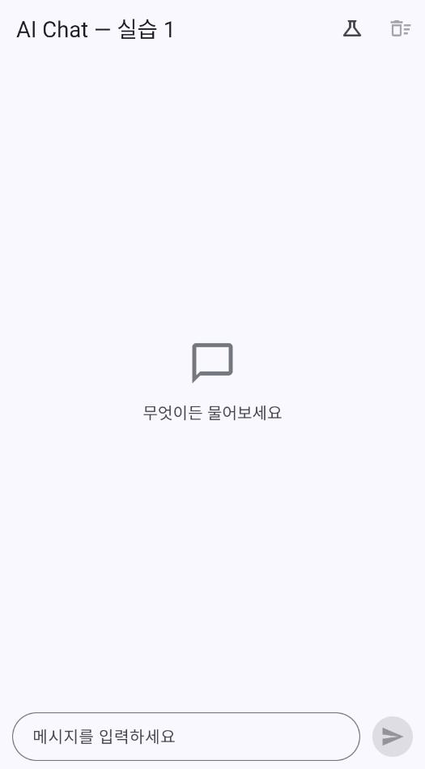
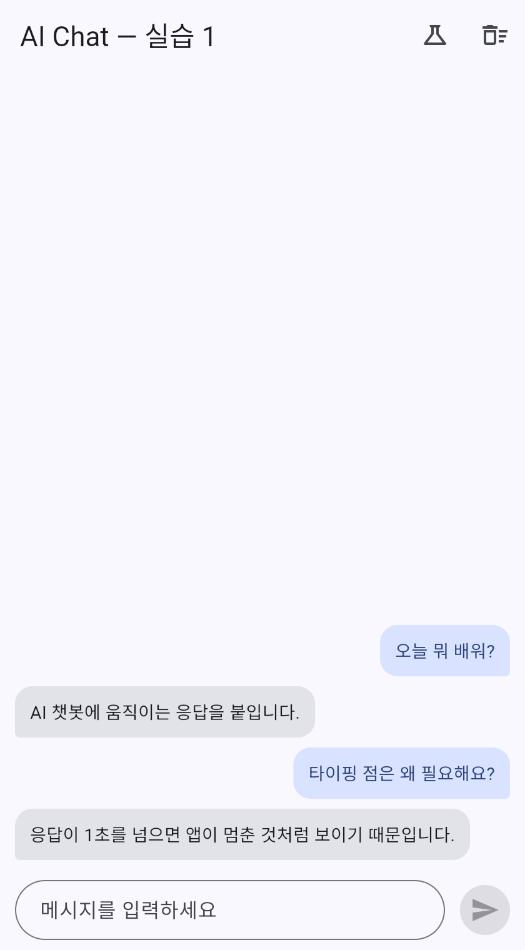
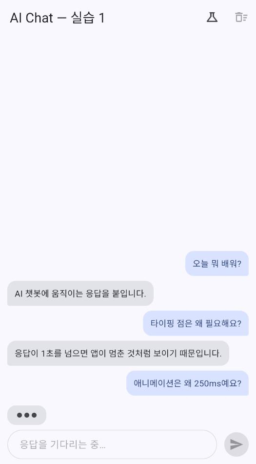
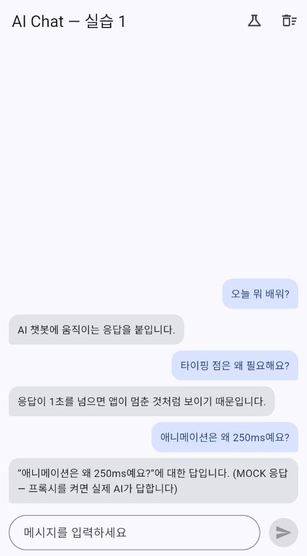
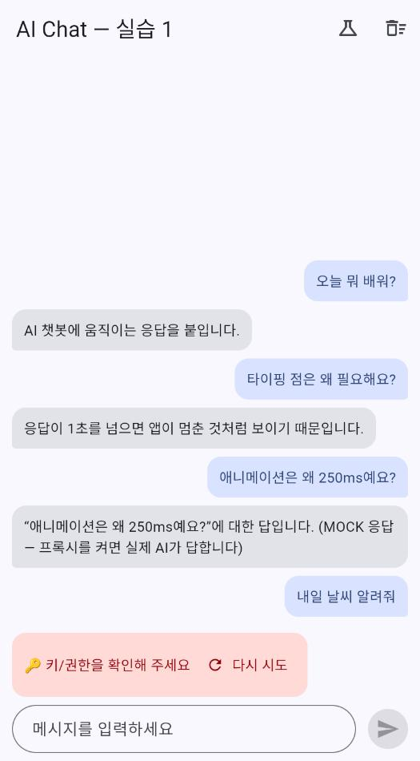

# gai3008-w11-chat-imwonji — AI 챗봇 채팅 UI + 오류·재시도

GAI3008-01 응용모바일프로그래밍 · 11주차 과제
실습 1(채팅 UI, `TODO 2`~`TODO 5`)과 실습 4(오류와 재시도)를 혼자 끝까지 만들고 단계마다 커밋했다.
스타터: [xide-projext/yonsei_gai3008_w11_lab1_chat_ui](https://github.com/xide-projext/yonsei_gai3008_w11_lab1_chat_ui)

## 개선된 화면

| 빈 상태 | 대화 | typing (점 3개) | 답 도착 | error + 다시 시도 |
|---|---|---|---|---|
|  |  |  |  |  |

## 실행

```bash
flutter pub get
flutter run -d chrome                               # MOCK 응답 (서버 없이)
flutter run -d chrome --dart-define=USE_PROXY=true  # 프록시 localhost:8787/api/chat
flutter test                                        # 위젯 테스트 8개
```

앱바의 🧪 메뉴에서 MOCK 응답 모드를 바꿔 오류를 직접 만들 수 있다:
정상 · 401 · 429 · 500 · 타임아웃 · 429 두 번 후 성공(백오프 확인).

## 실습 1 — 채팅 UI

| # | 내용 | 구현 |
|---|---|---|
| 1 | `ListView.builder` + `reverse: true` | 스타터 제공 |
| 2 | 말풍선 2종 | 사용자 오른쪽 `primaryContainer` / AI 왼쪽 `surfaceContainerHighest`, `maxWidth: 420`, 꼬리 쪽 모서리만 작게 |
| 3 | 입력창 + 전송 | `TextField` + `IconButton.filled`, Enter 전송, 빈 입력이면 버튼 비활성(피드포워드), `dispose()` 정리 |
| 4 | 빈 상태 | `Stack`으로 목록 위에 "무엇이든 물어보세요", 앱바 '대화 지우기'로 확인 |
| 5 | 키보드 | `resizeToAvoidBottomInset: true` + `SafeArea`, 목록을 끌면 키보드 닫힘 |

## 실습 4 — 오류와 재시도

| 할 일 | 구현 |
|---|---|
| 401·429·500·timeout을 한 상태로 | `AiException(status)` → `_error` 문구 하나. 401 "키/권한을 확인해 주세요" · 429 "잠시 후 다시 시도해 주세요" · 500 "응답을 받지 못했습니다" · timeout(30초) "네트워크를 확인해 주세요" |
| 오류 말풍선 + 다시 시도 | `errorContainer` 색 말풍선 + `다시 시도` 버튼, 화면에 남는다 |
| 재시도는 마지막 메시지를 다시 | `_lastPrompt`를 다시 요청, 내 말풍선은 중복되지 않음 |
| AnimatedSwitcher로 전환 | idle ↔ typing ↔ error를 200ms 페이드+크기 전환, 한 번에 하나 |
| 429 지수 백오프 1s → 2s | 429면 1s, 2s 기다리며 자동 재시도, 그래도 429면 오류 말풍선 |

추가로:
- **상태**: `idle · sending(입력 잠금, 연타 방지) · typing(점 3개) · done · error`
- **Reduce Motion**: `MediaQuery.disableAnimations`면 전환 0ms, 점 3개는 멈춘 채 모두 표시(정보 유지)
- **스크롤**: 새 메시지 뒤 `animateTo(0)` 200ms
- **키는 앱에 없다**: `ProxyAiClient`는 `localhost:8787`만 안다 (Android 에뮬레이터는 `10.0.2.2:8787`)

## 구조

```
lib/main.dart          화면·상태 (말풍선, 입력창, 빈 상태, 점 3개, 오류 말풍선)
lib/ai_client.dart     AiClient · ProxyAiClient · MockAiClient · AiException
test/widget_test.dart  전송·typing·오류·재시도·Reduce Motion·백오프 테스트
docs/w11.md            포트폴리오 5칸
```

## 커밋 단계

1. 할 일 2 — 말풍선 2종
2. 할 일 3 — 입력창 + 전송 버튼
3. 할 일 4 — 빈 상태
4. 할 일 5 — 키보드
5. 실습 4-1 — AiClient, sending·typing, 점 3개
6. 실습 4-2 — error 상태, 오류 말풍선 + 다시 시도
7. 실습 4-3 — AnimatedSwitcher, Reduce Motion, 스크롤
8. 실습 4-4 — 429 지수 백오프
9. README · 스크린샷 · docs/w11.md

---

스타터 ⓒ 2026 Baryon Labs · 연세대학교 GAI3008-01 응용모바일프로그래밍 교육자료
